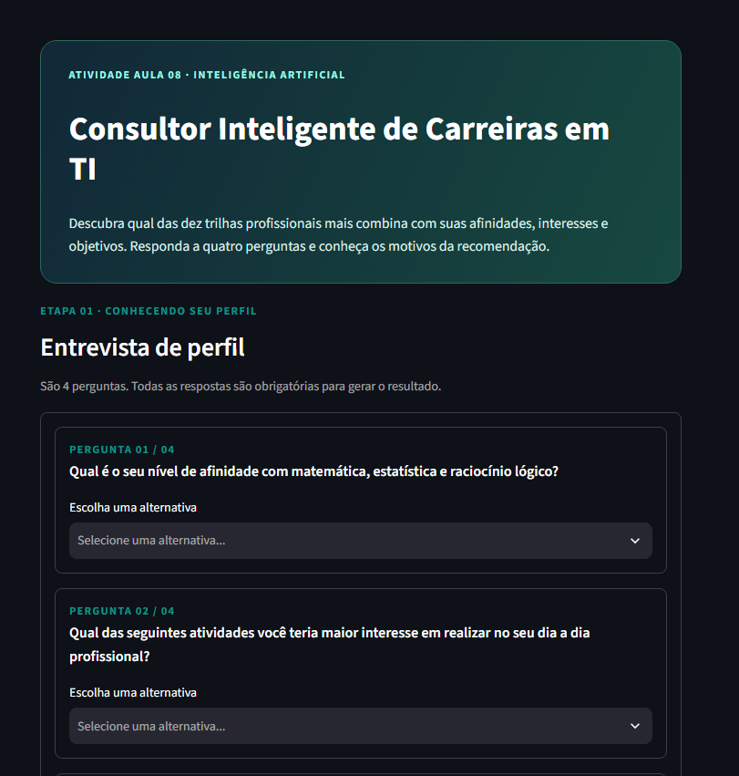
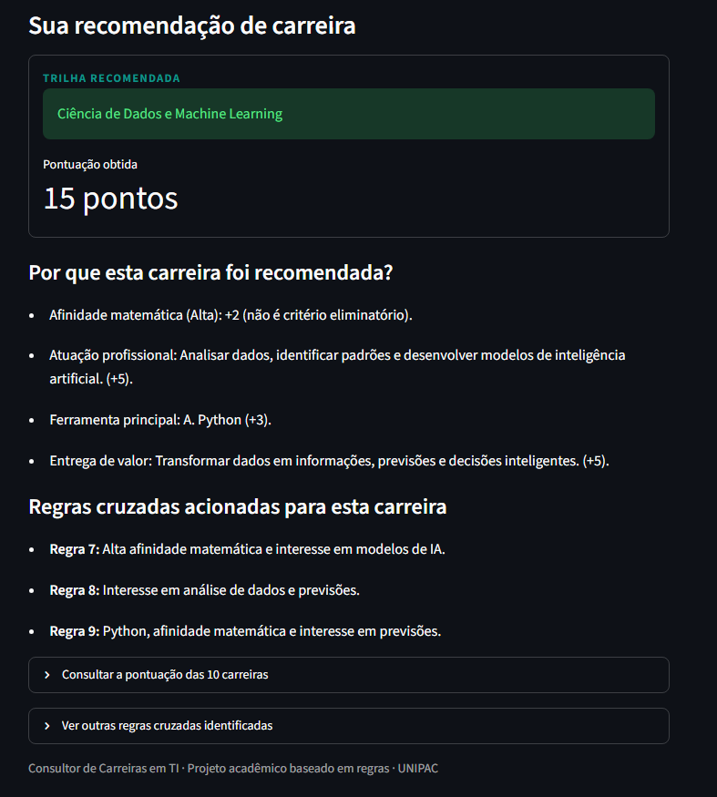
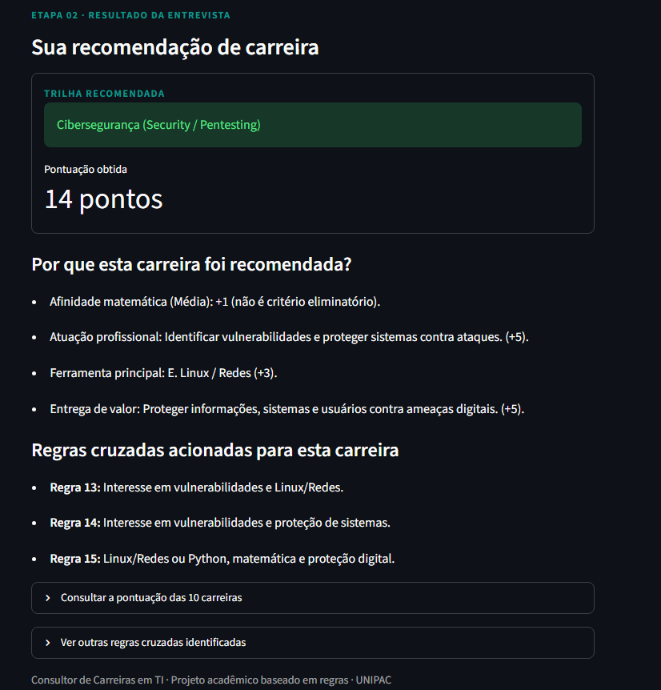
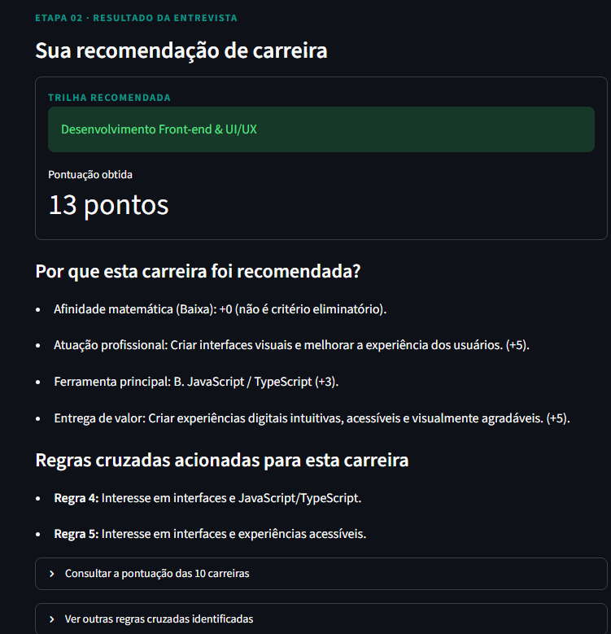
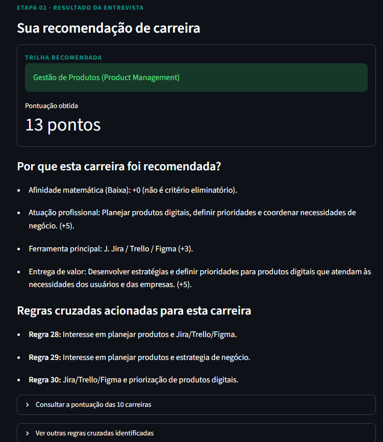
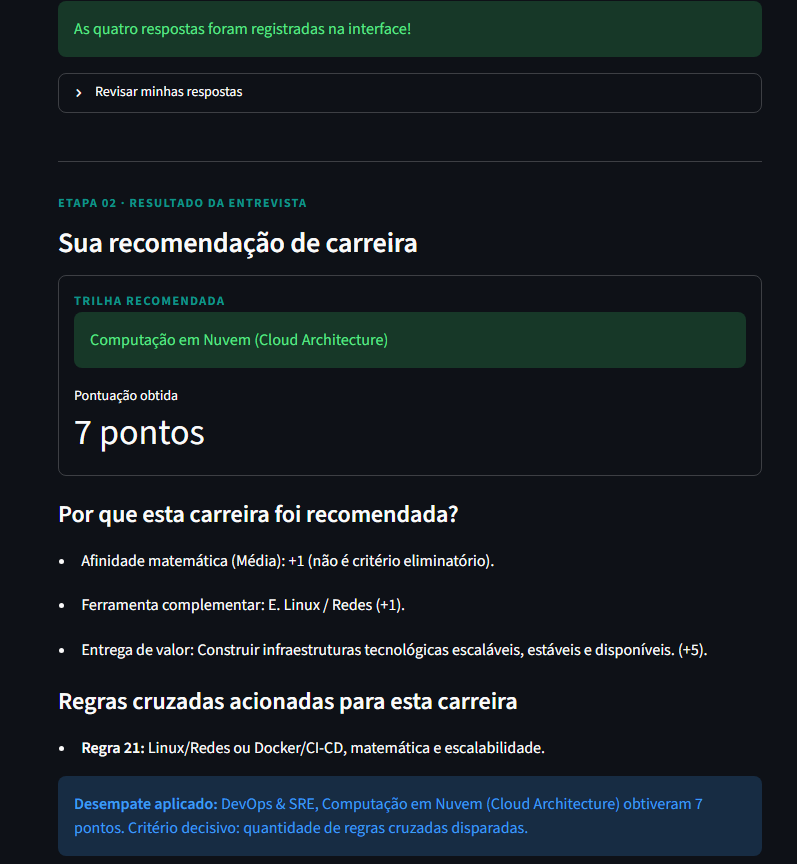
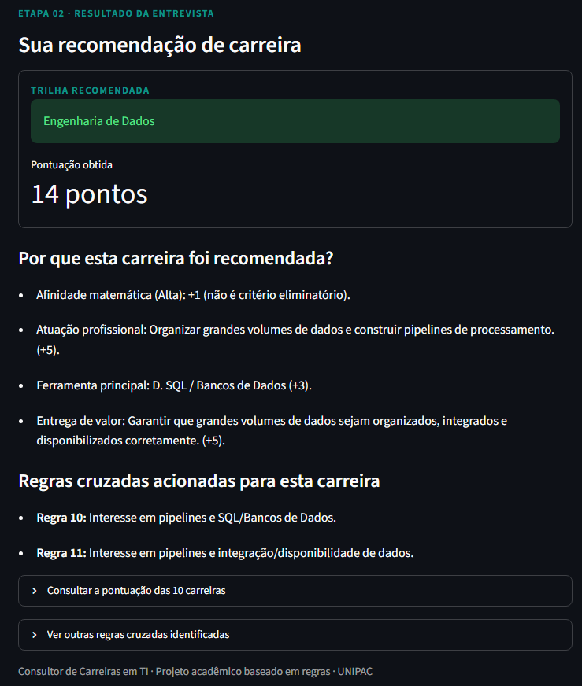
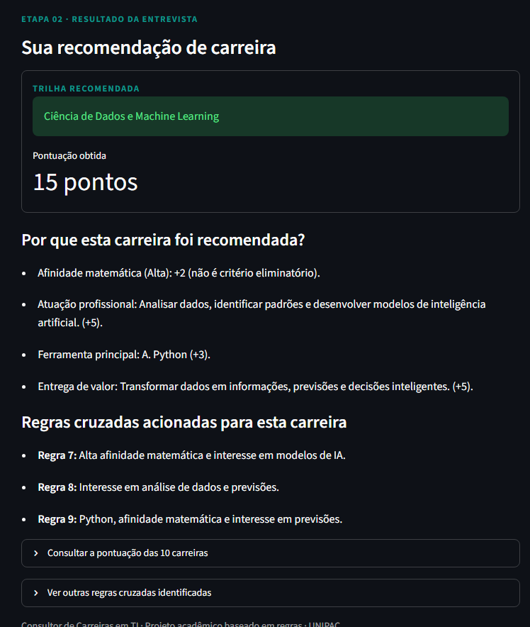
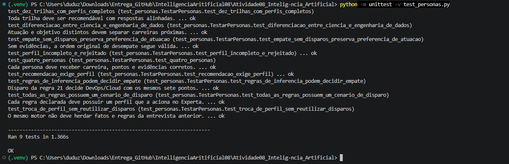

# Relatório de Resultados — Consultor Inteligente de Carreiras em TI

**Atividade:** Aula 08 — Inteligência Artificial  
**Projeto:** Sistema Especialista Consultor Inteligente de Carreiras em TI  
**Tecnologias:** Python, Experta e Streamlit  
**Validações registradas:** 22 de outubro de 2026  
**Repositório:** [Atividade08_Intelig-ncia_Artificial](https://github.com/kduzim01/Atividade08_Intelig-ncia_Artificial) 

**Desenvolvedor:** Carlos Eduardo Santos Almeida


## 1. Apresentação

Este documento reúne **resultados observados e evidências visuais** do sistema especialista desenvolvido para recomendar trilhas profissionais em Tecnologia da Informação. O sistema considera quatro dimensões de uma entrevista: afinidade matemática, preferência de atuação, ferramenta ou linguagem de interesse e tipo de entrega de valor. Ao concluir a entrevista, apresenta uma carreira recomendada, sua pontuação e a justificativa baseada na matriz de decisão e nas regras de inferência efetivamente acionadas.

O presente relatório complementa o arquivo [`relatorio_validacao.md`](relatorio_validacao.md), que registra os procedimentos técnicos, os critérios de aprovação e as limitações da validação. As imagens a seguir são **capturas reais da aplicação e do terminal**, obtidas durante os testes do projeto.

## 2. Interface web e apresentação dos resultados

A interface desenvolvida em Streamlit conduz a entrevista por quatro perguntas obrigatórias. Após o preenchimento, exibe a recomendação de carreira, os fatores que contribuíram para a pontuação e as regras cruzadas identificadas pelo motor.



*Figura 1 — Formulário de entrevista da aplicação Streamlit.*

## 3. Resultados das quatro personas de validação

As quatro personas estabelecidas para a validação original foram executadas na interface, com os seguintes resultados:

| Persona avaliada | Carreira recomendada | Pontuação | Regras exibidas | Resultado |
|---|---|---:|---|---|
| Analítica | Ciência de Dados e Machine Learning | 15 | 7, 8 e 9 | Aprovado |
| Infraestrutura e segurança | Cibersegurança (Security / Pentesting) | 14 | 13, 14 e 15 | Aprovado |
| Visual/front-end | Desenvolvimento Front-end & UI/UX | 13 | 4 e 5 | Aprovado |
| Negócios e produtos | Gestão de Produtos (Product Management) | 13 | 28, 29 e 30 | Aprovado |

As recomendações obtidas corresponderam às expectativas definidas para os quatro perfis. A interface apresentou a decomposição da pontuação e os identificadores das regras associadas à carreira vencedora.

### 3.1. Persona analítica — Ciência de Dados e Machine Learning

A combinação de alta afinidade matemática, interesse em modelos de inteligência artificial, preferência por Python e geração de previsões resultou em **15 pontos**, com disparo das regras **7, 8 e 9**.



*Figura 2 — Resultado da persona analítica.*

### 3.2. Persona de infraestrutura e segurança — Cibersegurança

O interesse em vulnerabilidades, proteção de sistemas e ferramentas Linux/Redes resultou em **14 pontos**, com disparo das regras **13, 14 e 15**.



*Figura 3 — Resultado da persona de infraestrutura e segurança.*

### 3.3. Persona visual — Front-end e UI/UX

A preferência pela criação de interfaces, o uso de JavaScript/TypeScript e a preocupação com a experiência dos usuários resultaram em **13 pontos**, com disparo das regras **4 e 5**.



*Figura 4 — Resultado da persona visual/front-end.*

### 3.4. Persona de negócios — Gestão de Produtos

O interesse em planejamento de produtos digitais, organização de prioridades e uso de Jira/Trello/Figma resultou em **13 pontos**, com disparo das regras **28, 29 e 30**.



*Figura 5 — Resultado da persona de negócios e produtos.*

**Nota sobre o histórico:** as quatro capturas anteriores pertencem à validação original da interface. Após a refatoração do motor, os mesmos quatro perfis voltaram a ser aprovados nos testes automatizados. Não foi registrada uma nova rodada manual completa desses quatro casos após a refatoração.

## 4. Resultados adicionais após a refatoração

A política de decisão passou a considerar as **regras cruzadas efetivamente disparadas como primeiro critério de desempate** entre carreiras que obtêm a mesma maior pontuação. As regras não acrescentam pontos à matriz ponderada. Se a contagem de regras não solucionar o empate, permanecem os critérios de atuação profissional, entrega de valor, ferramenta principal e afinidade matemática, nessa ordem.

Foram verificados três cenários adicionais diretamente na interface Streamlit:

| Cenário | Recomendação exibida | Pontuação | Regras da carreira | Evidência observada |
|---|---|---:|---|---|
| Empate entre DevOps e Cloud | Computação em Nuvem (Cloud Architecture) | 7 | 21 | Regra cruzada decidiu o empate |
| Perfil de Engenharia de Dados | Engenharia de Dados | 14 | 10 e 11 | Preferência por pipelines e integração |
| Perfil de Ciência de Dados | Ciência de Dados e Machine Learning | 15 | 7, 8 e 9 | Preferência por análise e previsão |

### 4.1. Desempate entre DevOps e Cloud

DevOps & SRE e Computação em Nuvem obtiveram **7 pontos**. A interface exibiu **Computação em Nuvem** como vencedora e identificou a **quantidade de regras cruzadas disparadas** como critério decisivo. A Regra 21 forneceu evidência à trilha de Cloud.



*Figura 6 — Evidência visual do desempate com uso da Regra 21.*

### 4.2. Diferenciação de Engenharia de Dados

O perfil direcionado à construção de pipelines de processamento e à integração de dados recebeu a recomendação de **Engenharia de Dados**, com **14 pontos** e as regras **10 e 11**.



*Figura 7 — Recomendação para Engenharia de Dados.*

### 4.3. Diferenciação de Ciência de Dados

O perfil direcionado a análise de dados, modelagem e previsões recebeu a recomendação de **Ciência de Dados e Machine Learning**, com **15 pontos** e as regras **7, 8 e 9**.



*Figura 8 — Recomendação para Ciência de Dados e Machine Learning.*

A comparação das Figuras 7 e 8 demonstra, nos perfis examinados, a diferenciação entre atividades de infraestrutura/processamento de dados e atividades de análise/modelagem preditiva.

## 5. Resultados dos testes automatizados

A suíte de validação foi executada com o motor real baseado na biblioteca Experta. Na versão refatorada, foram verificados **nove métodos de teste** no arquivo `test_personas.py`.

| Verificação automatizada | Resultado registrado |
|---|---|
| Recomendações, pontuações, justificativas e regras das quatro personas | Aprovado |
| Troca de perfil sem reutilizar fatos ou disparos anteriores | Aprovado |
| Diferenciação entre Ciência de Dados e Engenharia de Dados | Aprovado |
| Possibilidade de recomendar as dez trilhas com perfis alinhados | Aprovado |
| Aplicação das regras cruzadas no desempate DevOps/Cloud | Aprovado |
| Desempate sem regras pela preferência de atuação | Aprovado |
| Existência de um cenário capaz de disparar cada uma das 30 regras | Aprovado |
| Bloqueio de recomendação sem perfil registrado | Aprovado |
| Rejeição de perfil com dimensão obrigatória ausente | Aprovado |

**Comando executado:**

```powershell
python -m unittest -v test_personas.py
```

**Resultado registrado no terminal:**

```text
Ran 9 tests in 1.366s

OK
```



*Figura 9 — Execução da suíte de testes automatizados com nove aprovações.*

O registro confirma que os **nove métodos de teste foram aprovados sem falhas ou erros reportados** na execução apresentada.

## 6. Análise complementar de combinações

A entrevista possui **3.300 combinações possíveis** de respostas (3 × 10 × 11 × 10). Uma análise combinatória local, baseada em **simulação declarativa** das condições das regras e da política de desempate, identificou **61 combinações com mudança da carreira vencedora** em relação à política anterior e **nenhum empate sem resolução naquela simulação**.

Essa análise **não equivale a 3.300 execuções com o motor Experta real**, nem a testes automatizados da interface no navegador. Por esse motivo, seus resultados são apresentados somente como evidência complementar, sem substituir a suíte automatizada ou os testes manuais documentados.

## 7. Síntese e limitações dos resultados

Os testes evidenciaram que, nos cenários verificados, o consultor:

- Apresentou recomendações e pontuações coerentes com a matriz cadastrada e os perfis utilizados;
- Tornou visíveis os fatores de pontuação e as regras de inferência acionadas;
- Diferenciou carreiras com afinidades próximas, em especial Ciência de Dados e Engenharia de Dados;
- Aplicou a nova política de desempate por evidências de regras sem alterar artificialmente as pontuações;
- Concluiu nove testes automatizados com resultado `OK`.

**Limitações:** os resultados comprovam os casos executados, e não precisão profissional de 100% para qualquer usuário. Os pesos representam critérios acadêmicos de compatibilidade. As capturas de interface não constituem uma suíte de testes automatizados ponta a ponta. Além disso, a simulação combinatória não substitui a execução exaustiva com Experta.

## 8. Conclusão

O conjunto de resultados obtidos foi **satisfatório nos cenários avaliados**, demonstrando o funcionamento integrado da entrevista Streamlit, da matriz de decisão e do motor de inferência Experta. As quatro personas originais e os três cenários complementares apresentaram os resultados documentados, enquanto a suíte de nove testes foi concluída sem falhas.

As imagens reunidas neste documento registram de forma visual o comportamento da aplicação e a execução dos testes, complementando a documentação técnica já presente no repositório.

**Documentos relacionados:** [`README.md`](README.md), [`matriz_decisao.md`](matriz_decisao.md), [`relatorio_validacao.md`](relatorio_validacao.md) e [`test_personas.py`](test_personas.py).
